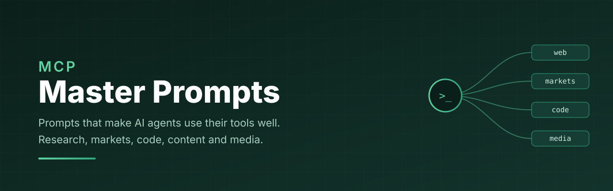

<p align="center">
  
</p>

<h1 align="center">MCP Master Prompts</h1>

<p align="center">
  <b>Copy and paste prompts that turn an AI agent with MCP tools into a careful analyst.</b><br>
  Web research, markets and finance, trading strategy automation, marketing, creative media, engineering, documents, and multi tool chains.
</p>

<p align="center">
  <a href="LICENSE"></a>
  <a href="#prompt-catalog"></a>
  <a href="#prompt-catalog"></a>
  <a href="docs/principles.md"></a>
  <a href="CONTRIBUTING.md"></a>
</p>

<p align="center">
  <b>Works with:</b> Claude Code · Claude Desktop · Cursor · Windsurf · Codex CLI · Gemini CLI · any MCP client
</p>

---

## Why this exists

Connecting an MCP server gives an agent new hands. It does not give it judgement. Left alone, most agents call one tool, read the first result, and write a confident summary on top of it.

The prompts in this repo fix that. Each one tells the agent which tools to reach for, in what order, what evidence counts, when to stop and ask, and what the final output must look like. The result is analysis you can check, not a paragraph you have to trust.

### Plain prompt vs master prompt

|  | Plain prompt | Master prompt |
| --- | --- | --- |
| **Tool use** | Whatever the agent picks first | Named tools, ordered steps, fallbacks |
| **Evidence** | Often one source | Several sources, cross checked, cited |
| **Numbers** | Recalled from memory | Pulled live from a tool, with a timestamp |
| **Cost and risk** | Ignored | Budget checks and a confirm step before any write |
| **Output** | A wall of prose | A fixed structure you can scan and reuse |

---

## Quick start

```bash
git clone https://github.com/jasvina-wealthquant/mcp-master-prompts.git
cd mcp-master-prompts
```

1. Connect the MCP servers a prompt lists under **MCPs** (see [docs/mcp-setup.md](docs/mcp-setup.md)).
2. Open the prompt file, copy the block under **The prompt**, and fill the `{{placeholders}}`.
3. Paste it into your agent. For best results, start with the [Universal Analyst system prompt](prompts/00-meta/universal-analyst-system-prompt.md) as a system or project instruction.

**Using Claude Code?** Save any prompt as a slash command:

```bash
mkdir -p ~/.claude/commands
cp prompts/01-web-research/deep-research-brief.md ~/.claude/commands/deep-research.md
# then type /deep-research in Claude Code
```

---

## Prompt catalog

**38 prompts across 9 domains.**

| Domain | Prompts | Highlights | Folder |
| --- | --- | --- | --- |
| **🧠 Meta and orchestration** | 5 | Universal analyst system prompt, tool discovery, plan then execute, verify and cite, cost guard | [00-meta/](prompts/00-meta) |
| **🌐 Web research** | 6 | Deep research brief, competitor teardown, fact check, news digest, pricing tracker, SEO and site audit | [01-web-research/](prompts/01-web-research) |
| **📈 Markets and finance** | 7 | Stock 360 view, portfolio concentration report (HTML with pie and bar charts), portfolio health check, earnings call digest, sector rotation scan, weekly market wrap, risk and exposure review | [02-markets-finance/](prompts/02-markets-finance) |
| **📣 Marketing and content** | 4 | Audience research, content repurposing engine, SEO content gap, campaign post mortem | [03-marketing-content/](prompts/03-marketing-content) |
| **🎬 Creative media** | 4 | Brand style kit builder, ad storyboard to video, budgeted image batch, music and sound brief | [04-creative-media/](prompts/04-creative-media) |
| **🔧 Engineering** | 4 | Codebase onboarding, GitHub issue triage, PR deep review, dependency and library audit | [05-engineering/](prompts/05-engineering) |
| **📄 Data and documents** | 3 | PDF to insights, spreadsheet analyst, meeting notes to actions | [06-data-documents/](prompts/06-data-documents) |
| **🔗 Multi MCP chains** | 2 | Research to publish pipeline, market signal to content pipeline | [07-multi-mcp-chains/](prompts/07-multi-mcp-chains) |
| **🤖 Trading strategies** `NEW` | 3 | Strategy builder master prompt (Strategy Card, backtest, paper trade, GO LIVE gate), short straddle example, point and figure breakout example | [08-trading-strategies/](prompts/08-trading-strategies) |

<details>
<summary><b>See every prompt</b></summary>

#### 🧠 Meta and orchestration
- [Universal Analyst system prompt](prompts/00-meta/universal-analyst-system-prompt.md): the base layer for every other prompt
- [Tool discovery and capability map](prompts/00-meta/tool-discovery.md): make the agent learn its tools before it uses them
- [Plan then execute](prompts/00-meta/plan-then-execute.md): a written plan, an approval gate, then action
- [Verify and cite](prompts/00-meta/verify-and-cite.md): a second pass that checks every claim against a source
- [Cost and side effect guard](prompts/00-meta/cost-guard.md): budgets, dry runs and confirmations for paid or write tools

#### 🌐 Web research
- [Deep research brief](prompts/01-web-research/deep-research-brief.md)
- [Competitor teardown](prompts/01-web-research/competitor-teardown.md)
- [Fact check a claim](prompts/01-web-research/fact-check.md)
- [News digest on a topic](prompts/01-web-research/news-digest.md)
- [Pricing and changelog tracker](prompts/01-web-research/pricing-tracker.md)
- [SEO and site audit](prompts/01-web-research/site-audit.md)

#### 📈 Markets and finance
- [Stock 360 view](prompts/02-markets-finance/stock-360-view.md)
- [Portfolio health check](prompts/02-markets-finance/portfolio-health-check.md)
- [Portfolio concentration report](prompts/02-markets-finance/portfolio-concentration-report.md): an HTML page with pie and bar charts of where your money sits
- [Earnings call digest](prompts/02-markets-finance/earnings-call-digest.md)
- [Sector rotation scan](prompts/02-markets-finance/sector-rotation-scan.md)
- [Weekly market wrap](prompts/02-markets-finance/weekly-market-wrap.md)
- [Risk and exposure review](prompts/02-markets-finance/risk-exposure-review.md)

#### 📣 Marketing and content
- [Audience research](prompts/03-marketing-content/audience-research.md)
- [Content repurposing engine](prompts/03-marketing-content/content-repurposing.md)
- [SEO content gap](prompts/03-marketing-content/seo-content-gap.md)
- [Campaign post mortem](prompts/03-marketing-content/campaign-post-mortem.md)

#### 🎬 Creative media
- [Brand style kit builder](prompts/04-creative-media/brand-style-kit.md)
- [Ad storyboard to video](prompts/04-creative-media/ad-storyboard-to-video.md)
- [Budgeted image batch](prompts/04-creative-media/budgeted-image-batch.md)
- [Music and sound brief](prompts/04-creative-media/music-sound-brief.md)

#### 🔧 Engineering
- [Codebase onboarding](prompts/05-engineering/codebase-onboarding.md)
- [GitHub issue triage](prompts/05-engineering/github-issue-triage.md)
- [PR deep review](prompts/05-engineering/pr-deep-review.md)
- [Dependency and library audit](prompts/05-engineering/dependency-audit.md)

#### 📄 Data and documents
- [PDF to insights](prompts/06-data-documents/pdf-to-insights.md)
- [Spreadsheet analyst](prompts/06-data-documents/spreadsheet-analyst.md)
- [Meeting notes to actions](prompts/06-data-documents/meeting-to-actions.md)

#### 🔗 Multi MCP chains
- [Research to publish pipeline](prompts/07-multi-mcp-chains/research-to-publish.md)
- [Market signal to content pipeline](prompts/07-multi-mcp-chains/market-signal-to-content.md)

#### 🤖 Trading strategies
- [Strategy builder master prompt](prompts/08-trading-strategies/strategy-builder-master-prompt.md): describe any strategy on a one page card, get a tested bot
- [Example: short straddle on a 15 minute chart](prompts/08-trading-strategies/examples/short-straddle-ema.md)
- [Example: point and figure breakout for swing trades](prompts/08-trading-strategies/examples/point-and-figure-breakout.md)

</details>

---

## Featured: build your own trading strategy

Describe any strategy in plain words on a one page **Strategy Card**. The [strategy builder master prompt](prompts/08-trading-strategies/strategy-builder-master-prompt.md) makes the agent restate it, flag every ambiguous rule, build it in small tested modules, backtest it on the same code it will trade with, paper trade it, and go live only when you type `GO LIVE`.

```text
Phase 0  Understand   restate the card, list ambiguities and risks      → you answer
Phase 1  Data         contracts, candles, indicators, charts             → you check signals by eye
Phase 2  Rules        signals and risk as unit tested functions          → you review tests
Phase 3  Backtest     same code, real costs, in and out of sample        → you decide
Phase 4  Paper        dry run fills, full logs, daily summary            → you decide
Phase 5  Live         only after GO LIVE, smallest size, kill switch on
```

---

## Anatomy of a master prompt

Every file follows the same shape, so you always know where to look.

```text
# Title
> One line on what it produces

MCPs        which servers it needs, with examples
Inputs      the placeholders you fill in
The prompt  the copy and paste block
Why it works  the design choices, so you can adapt them
Variations  quick tweaks for related jobs
```

Inside each prompt block you will see the same five parts:

1. **Role and goal.** Who the agent is and what done looks like.
2. **Tool plan.** Which tools to call, in what order, and what to do when one fails.
3. **Evidence rules.** What counts as a source, how fresh it must be, how to handle conflicts.
4. **Guardrails.** Budgets, confirmations, and things the agent must never do.
5. **Output contract.** The exact sections and format of the answer.

Read [docs/principles.md](docs/principles.md) for the ten rules behind these choices.

---

## MCP servers these prompts are written for

The prompts name tool *types*, so you can swap in whichever server you use.

| Tool type | Example servers | Used in |
| --- | --- | --- |
| Web search and scrape | Firecrawl, Brave Search, Exa, Fetch | Research, marketing, chains |
| Broker and market data | Zerodha Kite, Alpaca, Polygon, Yahoo Finance | Markets and finance |
| Code and repos | GitHub, Git, Filesystem | Engineering |
| Creative generation | Artlist, Higgsfield, Replicate | Creative media |
| Documents and data | Filesystem, Google Drive, Notion, SQLite, Postgres | Data and documents |
| Browser automation | Playwright, Puppeteer | Audits, QA, logged in pages |

Setup notes for each type live in [docs/mcp-setup.md](docs/mcp-setup.md).

---

## Contributing

New prompts are welcome. Copy [PROMPT_TEMPLATE.md](PROMPT_TEMPLATE.md), test it against a real MCP server at least twice, and open a pull request. The full checklist is in [CONTRIBUTING.md](CONTRIBUTING.md).

## Disclaimer

The markets, finance and trading strategy prompts produce research and engineering aids, not investment advice. Automated trading can lose money quickly; the strategy builder defaults to simulation and needs your explicit go ahead before any live order. Outputs depend on live tool data that can be delayed or wrong. Always verify before you act, and consult a registered adviser for decisions about your money.

## License

[MIT](LICENSE). Use them, fork them, ship them.

<p align="center"><sub>If this saved you time, a ⭐ helps others find it.</sub></p>
